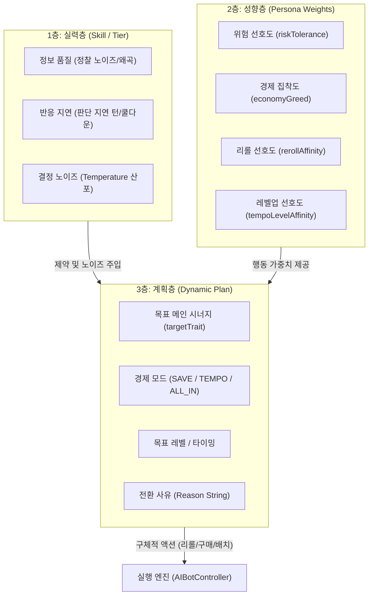
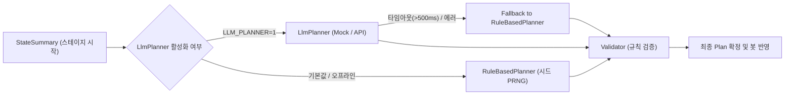

# 봇 지능 3층 구조 및 페르소나/전략 전환 설계서

> **문서 상태**: 설계 초안 (RFC)  
> **관련 브랜치**: `ai-improve`  
> **제약 사항**: 100% 오프라인 작동, 시드 PRNG 재현성 보장, 기존 게임 로직 플래그로 100% 보존 가능

---

## 1. [Part A] 현재 구조 분석 (As-Is Codebase)

### 1.1 `brain.persona`를 읽는 모든 지점 및 변경 영향 표

현재 코드베이스에서 AI의 페르소나(`AIPersona`)를 참조하는 모든 코드 위치와, 해당 지점이 실제 제어하는 의사결정 파라미터는 다음과 같습니다:

| 파일:줄번호 | 함수 / 코드 블록 | 제어하는 값 / 의사결정 내용 | 페르소나별 구체적 분기 |
| :--- | :--- | :--- | :--- |
| `src/AIBotController.ts:334~336` | `prepareBotForRealTimePrep` | 고블린 캐시아웃 턴(`isGoblinCashoutTurn`) 판단 | `GOBLIN_GAMBLER`: 체력 <= 35 또는 금고 >= 55스택 시 캐시아웃 플래그 ON |
| `src/AIBotController.ts:347~353` | `prepareBotForRealTimePrep` | 라운드 최소 유지 골드 하한선(`targetGoldFloorThisRound`) 산출 | `getPersonaGoldFloor()` 호출하여 페르소나별 10~50G 하한선 결정 |
| `src/AIBotController.ts:365~378` | `prepareBotForRealTimePrep` | 정비 단계 최대 리롤 횟수(`maxRerollsAllowedThisRound`) 산출 | • `HYPER_ROLLER`(5~6렙): 12회<br>• `FAST_NINE_GREEDY`(<8렙): 무료리롤 또는 1회<br>• 기타: 7회 (위기/캐시아웃 시 20회) |
| `src/AIBotController.ts:492~515` | `performPersonaLevelUpStep` | 정비 단계 레벨업(`buyXp`) 실행 여부 및 타이밍 | • `HYPER_ROLLER`: 5렙 미만 또는 3성 2개 이상일 때만 레벨업<br>• `FAST_NINE_GREEDY`: 50G 유지하며 10레벨까지 무제한 구매<br>• `GOBLIN_GAMBLER`: 캐시아웃 전 Lv.6, 캐시아웃 후 Lv.9 목표<br>• `FLEX_MASTER`: `stageNum + 3` 목표 정석 레벨업 |
| `src/AIBotController.ts:829~868` | `chooseBotAugment` | 증강체 선택 선호도 가중치 (`score` 계산) | • `HYPER_ROLLER`: 리롤/복제 증강(+75), 3성 완성 후 전투 증강(+50)<br>• `FAST_NINE_GREEDY`: 경제/헤지펀드/레벨업(+70), 8렙 후 전투(+60)<br>• `GOBLIN_GAMBLER`: 고블린관/사악한금융/계산된손실(+80)<br>• `FLEX_MASTER`: 전투(+40), 아이템(+35) |
| `src/AIBotController.ts:963` | `performScoutingAndPivot` | 피봇 발동 예외 조건 게이트 | `GOBLIN_GAMBLER`이면서 금고 12스택 이상이면 피봇 전면 차단 |
| `src/AIBotController.ts:1018~1020` | `executeInstantTurnFallback` | 즉시 턴 마무리 캐시아웃 플래그 판단 | `GOBLIN_GAMBLER`: 체력 <= 35 또는 금고 >= 55스택 판단 |
| `src/AIBotController.ts:1041~1072` | `executeInstantTurnFallback` | 폴백 레벨업 루프 | `performPersonaLevelUpStep`과 동일한 레벨업 규칙 적용 |
| `src/AIBotController.ts:1079~1091` | `executeInstantTurnFallback` | 폴백 리롤 상한(`maxRerollsThisTurn`) | `prepareBotForRealTimePrep`과 동일한 리롤 횟수 제한 적용 |
| `src/AIBotController.ts:1138~1153` | `getPersonaGoldFloor` | 페르소나별 기본 골드 하한선 계산 | • `FAST_NINE_GREEDY`: 50G (사악한 금융 70G), 8렙 이상 20G<br>• `HYPER_ROLLER`: 20G<br>• `GOBLIN_GAMBLER`: 40G<br>• `FLEX_MASTER`: 30G |
| `src/AIBotController.ts:1331~1354` | `evaluateUnitUtilityScore` | 상점 기물 구매 가치 점수 가산/감산 | • `HYPER_ROLLER`: 1~2코 +26, 4~5코 -20<br>• `FAST_NINE_GREEDY`: 4코 +36, 5코 +22, 1코 -25<br>• `GOBLIN_GAMBLER`: 고블린 기물 +55, 캐시아웃 시 4~5코 +34<br>• `FLEX_MASTER`: `cost * 5` 선형 가산 |
| `src/AIBotController.ts:1383~1385` | `cleanupBenchIfFull` | 대기석 정리 시 기물 보존 점수(`keepScore`) | `GOBLIN_GAMBLER`: 황금 고블린 기물 매각 방지 가산(+45) |
| `src/AIBotController.ts:1428~1430` | `executeExperimentalBenchClear` | 실험용 대기석 정리 시 보존 점수 가산 | `GOBLIN_GAMBLER`: 황금 고블린 기물 매각 방지 가산(+45) |
| `src/AIBotController.ts:1540~1542` | `rebuildBoardOptimally` | 샌드배깅(의도적 연패) 판단 | `GOBLIN_GAMBLER`: 체력 > 35 및 금고 < 55 시 보드 1명 비우기 |
| `src/AIBotController.ts:1553~1556` | `rebuildBoardOptimally` | 보드 출전 기물 선정 파워 점수 가산 | `GOBLIN_GAMBLER`: 황금 고블린 기물 보드 배치 최우선(+70) |
| `src/GameLoopManager.ts:935` | `createGhostParticipantClone` | 고스트 참가자 복제 시 페르소나 전달 | 홀수 생존자 고스트 생성 시 원본 봇의 `source.persona` 복제 |
| `src/main.ts:1390~1393` | `renderHeaderRight` | 정찰 배너의 페르소나 텍스트 뱃지 노출 | `PERSONA_BADGE_LABELS[viewed.persona]` 렌더링 |

---

### 1.2 페르소나 변경 시 함께 갱신해야 하는 상태 및 캐시 분석

페르소나가 런타임(예: 스테이지 시작 시점)에 전환될 경우, 다음 상태들을 반드시 동기화 및 갱신해야 합니다:

1. **`Participant.persona` (`src/Participant.ts:70`)**:
   - 봇 객체 자체의 페르소나 속성. UI 정찰 배너 및 고스트 복제 시 참조되므로 즉시 갱신되어야 합니다.
2. **`BotBrainState.persona` (`src/AIBotController.ts:36`)**:
   - 두뇌 상태 객체 내부의 페르소나 enum.
3. **`targetGoldFloorThisRound` (`src/AIBotController.ts:46`)**:
   - **위험**: 정비 단계 시작 시 `getPersonaGoldFloor`로 한 번 계산되어 라운드 내내 고정됩니다. 페르소나가 바뀌었는데 이를 재계산하지 않으면 이전 페르소나의 골드 하한(예: FAST_NINE의 50G)이 유지되어 즉각적인 리롤/레벨업 전환이 작동하지 않습니다.
   - **조치**: 전환 즉시 새 페르소나 기준 `getPersonaGoldFloor()`를 재호출하여 갱신해야 합니다.
4. **`maxRerollsAllowedThisRound` (`src/AIBotController.ts:45`)**:
   - 정비 단계 시작 시 페르소나에 따라 1회~12회로 하드코딩 설정됩니다.
   - **조치**: FAST_NINE(1회)에서 HYPER_ROLLER(12회)로 전환 시 즉시 상한을 올려주어야 남은 턴 동안 리롤을 수행할 수 있습니다.
5. **`isRolldownActive` (`src/AIBotController.ts:42`)**:
   - `GOBLIN_GAMBLER` 캐시아웃 플래그에 의존적입니다. 고블린에서 타 페르소나로 전환 시 캐시아웃 롤다운 상태가 비정상 지속되지 않도록 재평가해야 합니다.
6. **`bot.goblinVaultStacks` (`src/Participant.ts:77`)**:
   - `GOBLIN_GAMBLER`에서 다른 페르소나로 전환 시, 황금 고블린 시너지가 해제되면 스택 누적은 멈추지만 남은 스택 값 처리가 필요합니다 (매각/보존 정책).
7. **`unitsToDenyCache` 및 `deniedUnitInstanceIds` (`src/AIBotController.ts:40, 47`)**:
   - 페르소나 의존 값이 아닌 인간 플레이어 저격용 캐시이므로 페르소나 전환 시 초기화할 필요는 없습니다.

---

### 1.3 `AI_SKILL_BY_TIER` 파라미터의 실제 사용처 전수 조사

`src/RankManager.ts:72~81`에 정의된 3가지 파라미터의 실제 사용 위치는 다음과 같습니다:

```ts
// src/RankManager.ts:72~81
const AI_SKILL_BY_TIER: Record<RankTier, AISkillParameters> = {
  IRON: { skillLevel: 0.25, temperature: 0.8, scoutingChance: 0.0 },
  BRONZE: { skillLevel: 0.35, temperature: 0.7, scoutingChance: 0.1 },
  SILVER: { skillLevel: 0.45, temperature: 0.58, scoutingChance: 0.22 },
  GOLD: { skillLevel: 0.55, temperature: 0.45, scoutingChance: 0.38 },
  PLATINUM: { skillLevel: 0.65, temperature: 0.35, scoutingChance: 0.55 },
  DIAMOND: { skillLevel: 0.78, temperature: 0.24, scoutingChance: 0.75 },
  MASTER: { skillLevel: 0.88, temperature: 0.16, scoutingChance: 0.85 },
  CHALLENGER: { skillLevel: 0.95, temperature: 0.1, scoutingChance: 0.9 },
};
```

1. **`skillLevel` (실제 사용 4곳)**:
   - `src/AIBotController.ts:940`: 인간 플레이어 기물 견제(Denial) 활성화 조건 (`skillLevel >= 0.7`).
   - `src/AIBotController.ts:960`: 덱 피봇(`performScoutingAndPivot`) 활성화 게이트 (`skillLevel >= 0.7`).
   - `src/AIBotController.ts:1136`: 저티어 골드 하한 실수 패널티 부과 (`skillLevel < 0.45 && Math.random() < 0.35 ? 20 : 0`).
   - `src/AIBotController.ts:1595`: 고티어 저격 배치(`scoutAndPositionCounter`) 활성화 (`skillLevel >= 0.7`).
2. **`temperature` (실제 사용 단 1곳)**:
   - `src/AIBotController.ts:1357`: 상점 기물 구매 효용 점수 계산(`evaluateUnitUtilityScore`)에서 단 하나의 수식에만 쓰임:
     `const noise = (Math.random() - 0.5) * aiParams.temperature * 38;`
   - **중요 사실**: `temperature`는 리롤 여부, 레벨업 여부, 증강체 선택, 덱 전환 판단 등 어떠한 거시적 의사결정에도 쓰이지 않으며, 오직 상점 기물 점수의 단순 난수 가산기로만 작동하고 있습니다.
3. **`scoutingChance` (실제 사용 단 1곳)**:
   - `src/AIBotController.ts:961`: `performScoutingAndPivot` 호출 시 정찰 시도 확률 게이트 (`Math.random() < aiParams.scoutingChance`).

---

### 1.4 UI 페르소나 노출 지점 및 갱신 방안

- **노출 위치**:
  - `src/main.ts:1386~1398` (`renderHeaderRight`):
    ```ts
    const personaLabel = viewed.persona ? PERSONA_BADGE_LABELS[viewed.persona] : '';
    scoutText.textContent = `🔍 ${viewed.name} (${personaLabel} · 🪙${viewed.gold}G)`;
    ```
- **갱신 메커니즘**:
  - `renderHeaderRight`는 매 애니메이션 프레임(또는 상태 변경 tick)마다 호출되므로, `participant.persona` 속성을 새 페르소나로 업데이트하기만 하면 **별도의 UI 리팩토링 없이도 즉시 다음 프레임에 정찰 배너 배지가 자동 갱신**됩니다.
  - 전환 연출(예: "🔄 전략 전환: 리롤 덱")을 주려면 `pushBannerNotification` 또는 말풍선 컴포넌트를 연계하면 됩니다.

---

## 2. [Part B] 봇 지능 3층 구조 제안 (Architecture)

기존의 하드코딩된 단일 `AIPersona` 구조를 **실력(Skill) - 성향(Persona) - 계획(Plan)**의 3층 구조로 분리합니다.



### 2.1 3개 층의 책임과 데이터 구조

#### 1) 실력층 (Skill Layer)
- **책임**: "저티어는 적응을 못 한다"가 아니라, **"더 늦게 알아채고, 정보를 왜곡되게 보며, 판단에 흔들림이 있다"**로 모델링합니다.
- **파라미터**:
  - `scoutingFidelity` (0.0~1.0): 상대 보드/시너지 관측 정확도. 저티어는 상대 유닛을 일부 놓치거나 경합도를 과소평가함.
  - `reactionLagRounds` (정수): 상황 변화(체력 폭락, 경합 쏠림) 인지 후 계획 전환까지 걸리는 지연 라운드 (예: 브론즈 2~3턴 지연, 마스터 즉각 인지).
  - `decisionNoise` (`temperature`): 효용 함수 및 평가 점수의 분산.

#### 2) 성향층 (Persona Layer - 행동 가중치 묶음)
- **책임**: 봇 고유의 플레이 스타일과 기질을 가중치 벡터로 표현합니다.
- **가중치 벡터 매핑표**:

| 가중치 필드 | 설명 | HYPER_ROLLER | FAST_NINE_GREEDY | GOBLIN_GAMBLER | FLEX_MASTER |
| :--- | :--- | :---: | :---: | :---: | :---: |
| `rerollAffinity` | 리롤 선호도 (저코스트 3성 작) | **0.95** | 0.10 | 0.50 | 0.50 |
| `levelUpAffinity` | 레벨업 템포 선호도 | 0.20 | **0.95** | 0.30 | 0.65 |
| `economyGreed` | 이자 보존 집착도 (50G 유지) | 0.30 | **0.90** | **0.85** | 0.60 |
| `riskTolerance` | 체력 손실 감수도 (연패 허용) | 0.40 | 0.70 | **0.95** | 0.30 |
| `lowCostPreference` | 1~2코스트 기물 선호 가중치 | **+30** | -25 | 0 | 0 |
| `highCostPreference`| 4~5코스트 기물 선호 가중치 | -20 | **+40** | +35(캐시아웃) | +15 |

- **`if (persona === ...)` 분기 대체 평가**:
  - 현재 산재된 `if (persona === 'HYPER_ROLLER')` 분기는 골드 하한과 리롤 상한, 기물 점수 등에 직접 하드코딩되어 있습니다.
  - 위 가중치 벡터 구조를 도입하면 `score += weights.lowCostPreference * (3 - cost)` 및 `targetFloor = 50 * weights.economyGreed` 형태로 수식화하여 **하드코딩 분기를 80% 이상 제거 가능**합니다.

#### 3) 계획층 (Plan Layer)
- **책임**: 현재 게임 상황과 성향층 가중치를 결합하여 수립된 실행 가능한 1~2단계 앞선 계획.
- **주요 상태**: `targetTrait`, `economyMode` (`SAVE_INTEREST`, `TEMPO_LEVEL`, `PANIC_ROLLDOWN`), `targetLevel`, `targetGoldFloor`.

---

### 2.2 피봇(시너지 전환)과 페르소나 전환: 합칠 것인가, 분리할 것인가?

> **[권고: 명확한 분리 (Separation of Concerns)]**
- **근거 1 (빈도와 비용의 비대칭성)**:
  - **시너지 전환(Pivot)**은 기물 겹침 회피를 위해 한 판에 1~2회 일어날 수 있는 전술적 기물 교체(비용: 기물 매각 손실)입니다.
  - **페르소나 전환(Strategy Shift)**은 플레이어의 "기질" 자체가 바뀌는 것(예: "패스트9를 포기하고 6렙에서 3성 리롤로 살 길을 찾겠다")으로, 판당 최대 1회 발생하는 거시적 전략 변경입니다.
- **근거 2 (직교성)**:
  - `FAST_NINE` 성향을 유지한 채 덱만 `DRAGONKIN`에서 `HOLY_EMPIRE`로 바꿀 수 있어야 합니다 (페르소나 유지, 시너지 전환).
  - 반대로 시너지는 `UNDEAD_SCOURGE`를 유지하면서 체력이 25로 떨어져 `FAST_NINE`에서 `HYPER_ROLLER`(생존 리롤)로 바뀔 수도 있습니다 (시너지 유지, 페르소나 전환).
- 따라서 **"성향층 전환(Persona Switch)"과 "계획층 전환(Synergy Pivot)"은 독립된 계층으로 분리**하여 다루는 것이 가장 유연하고 버그가 적습니다.

---

## 3. [Part C] 전략 전환 규칙 설계 (Switching Rules)

### 3.1 전환 트리거 후보 및 관측값

1. **내부 상태 (Self State)**:
   - `hp`: 현재 체력 및 체력 변화량 ($\Delta hp$).
   - `gold`: 보유 골드 및 라운드당 예상 수입.
   - `level`: 현재 레벨 및 다음 레벨 필요 XP.
   - `streak`: 연승/연패 카운터 (예: -4연패 이상).
   - `ownedCoreCopies`: 현재 메인 덱의 핵심 3/4코스트 기물 보유 장수 (전환 매몰 비용).
2. **관측 가능한 외부 상태 (Observable Opponent State)**:
   - `contestedBotsCount`: 나와 같은 메인 시너지를 2명 이상 활성화한 상대 봇 수.
   - `keyUnitPoolRemaining`: 전체 시너지 합산이 아니라, **해당 덱의 "핵심 에이스 기물 2종"의 풀 잔여 비율**.
   - `relativeBoardPowerRank`: 전체 8명 중 나의 추정 보드 파워 순위 (1~8위).

---

### 3.2 전환 대상 시너지 선택 점수식

기존의 "겹침이 가장 적은 시너지(빈집)"만 보는 방식을 폐기하고, **보유 기물 가치와 전환 비용, 핵심 풀 잔여량**을 종합 평가하는 점수식을 제안합니다:

$$\text{SuitabilityScore}(T) = V_{\text{owned}}(T) + P_{\text{core}}(T) - C_{\text{contest}}(T) - S_{\text{transition}}(T)$$

#### 변수 정의
1. $V_{\text{owned}}(T)$ (보유 기물 가치):
   - 대기석 및 보드에 이미 보유 중인 시너지 $T$ 소속 기물들의 골드 가치 $\times 1.5$ (2성은 $\times 2.0$).
2. $P_{\text{core}}(T)$ (핵심 기물 풀 가용성 점수):
   - 시너지 $T$의 3~4코스트 핵심 캐리 기물 2종의 잔여 풀 비율 ($0.0 \sim 1.0$) $\times 50$점.
3. $C_{\text{contest}}(T)$ (경합 감점):
   - 해당 시너지를 가고 있는 상대 수 $\times 35$점.
4. $S_{\text{transition}}(T)$ (전환 비용 패널티):
   - 현재 주력 덱의 기물들을 매각할 때 발생하는 기회비용 = 현재 보드의 기존 시너지 기물 총 골드 가치 $\times 0.6$.

#### 구체적 계산 예시 (라운드 3-5 시점)
- 현재 덱: `DRAGONKIN` (보드 가치 24G, 3명 경합, 4코 용족 잔여율 25%)
- 후보 덱 A (`ARCANE_TOWER`): 대기석에 2성 법사 1기 보유(6G 가치), 경합 0명(빈집), 4코 핵심 기물 잔여율 85%
  - $V = 6 \times 2.0 = 12$
  - $P = 0.85 \times 50 = 42.5$
  - $C = 0 \times 35 = 0$
  - $S = 24 \times 0.6 = 14.4$
  - **최종 점수 = $12 + 42.5 - 0 - 14.4 = 40.1$점 (전환 추천)**
- 후보 덱 B (`HOLY_EMPIRE`): 대기석 기물 0개, 경합 2명, 잔여율 40%
  - $V = 0$, $P = 20$, $C = 70$, $S = 14.4$
  - **최종 점수 = $-64.4$점 (전환 절대 불가)**

---

### 3.3 어색해 보이지 않게 하는 장치 (안정화 제약)

봇이 매 라운드 갈팡질팡 덱을 갈아엎는 "갈대 현상"을 원천 차단하기 위한 4대 안전장치:

| 상수 이름 | 제안 기본값 | 설명 |
| :--- | :---: | :--- |
| `EVALUATION_STAGE_WINDOW` | 스테이지 X-1, X-2 | 라운드 중간 난입 금지. 크립 라운드 직후 정비 시점에만 전략 평가 |
| `MAX_PERSONA_SWITCH_PER_GAME` | 1회 | 한 판에서 페르소나 전환은 최대 1회로 제한 |
| `MAX_TRAIT_PIVOT_PER_GAME` | 2회 | 시너지 덱 전환은 최대 2회로 제한 |
| `SWITCH_COOLDOWN_ROUNDS` | 5라운드 | 한 번 전환 후 최소 5라운드 동안 재전환 잠금 |
| `HYSTERESIS_THRESHOLD` | +25점 | 기존 덱 유지 점수보다 대안 점수가 최소 25점 이상 높아야만 전환 발동 |

---

### 3.4 페르소나 전환 예시 및 금지 매트릭스

| 출발 페르소나 | 발동 트리거 조건 | 도착 페르소나 | 전환 시 수행할 정리 작업 |
| :--- | :--- | :--- | :--- |
| **FAST_NINE_GREEDY** | 체력 $\le 38$ & 연패 $\ge 3$ (8렙 전) | **FLEX_MASTER** | 9렙 욕심 포기. 현재 레벨(6~7)에서 즉시 20G까지 리롤하여 2성 앞라인 확보 |
| **FAST_NINE_GREEDY** | 체력 $\le 28$ & 3명 이상 고밸류 경합 | **HYPER_ROLLER** | 비상 생존 올인 모드. 5~6렙 저코스트 2성/3성 즉시 완성하여 순방 방어 |
| **HYPER_ROLLER** | 4-1 시점 3성 0개 & 체력 $\le 40$ | **FLEX_MASTER** | 1코 3성 집착 포기, 레벨업 후 밸류 조합으로 전환 |
| **GOBLIN_GAMBLER** | 체력 $\le 32$ & 금고 스택 $< 30$ | **FLEX_MASTER** | 금고 포기 선언. 골드 전부 인출하여 즉시 2성 밸런스 보드 구성 |
| **FLEX_MASTER** | 체력 $\ge 85$ & 50G 유지 & 5연승+ | **FAST_NINE_GREEDY** | 스노우볼 우승 플랜. 정석 템포에서 고밸류 9레벨 직행으로 전환 |

#### [금지 조합 (Forbidden Transitions)]
- ❌ **`GOBLIN_GAMBLER` $\to$ `HYPER_ROLLER`**: 이미 골드를 축적하는 기물 구성을 갖춘 상태에서 1코 리롤로 역행하면 덱이 100% 붕괴함.
- ❌ **`HYPER_ROLLER` $\to$ `FAST_NINE_GREEDY`**: 이미 5~6레벨에서 골드를 털어 리롤한 봇이 9렙을 가려는 것은 자살 행위.

---

### 3.5 사유 문자열 (Reason String) 표준 규격

UI 말풍선, 콘솔 디버그 로그, LLM 설명문에서 공용으로 사용할 JSON 직렬화 규격:

```ts
export interface StrategyChangeReason {
  code: 'EMERGENCY_STABILIZE' | 'CONTESTED_ESCAPE' | 'SNOWBALL_VALUE' | 'CASHOUT_TRANSITION';
  koreanSummary: string; // 예: "체력 34, 4연패 위기 → 유연한 밸런스 덱으로 전환"
  metrics: {
    hp: number;
    gold: number;
    stage: string;
    triggerMetric: string; // "HP_CRITICAL (34 <= 38)"
  };
}
```

---

## 4. [Part D] StrategicPlanner 인터페이스 설계

### 4.1 데이터 인터페이스 (`StateSummary` & `Plan`)

```ts
/**
 * 봇이 관측할 수 있는 전장 요약 정보.
 * [중요: 전지적 정보 사용 금지]
 * 제외 대상: 상대방의 미공개 상점 패, 상대방의 비공개 리롤 시드, 상대방의 골드 이자 구간 외 정확한 1원 단위
 */
export interface ObservableStateSummary {
  botId: string;
  self: {
    hp: number;
    gold: number;
    level: number;
    xp: number;
    streak: number; // 양수: 연승, 음수: 연패
    boardValue: number;
    benchUnitCount: number;
    currentMainTrait: TraitId;
    coreUnitsRemainingRatio: number; // 현재 메인 덱 핵심 기물의 풀 잔여율
  };
  table: {
    stage: string; // 예: "3-2"
    traitContestCounts: Record<TraitId, number>; // 공개된 보드 기준 활성 시너지 수
    relativePowerRank: number; // 1~8위 추정치
    averageTableLevel: number;
  };
}

export interface StrategicPlan {
  botId: string;
  recommendedPersona: AIPersona;
  recommendedMainTrait: TraitId;
  economyAttitude: 'SAVE_INTEREST' | 'TEMPO_LEVEL' | 'AGGRESSIVE_ROLL' | 'PANIC_ALL_IN';
  riskAttitude: 'GREEDY' | 'BALANCED' | 'DEFENSIVE';
  confidence: number; // 0.0 ~ 1.0
  reason: StrategyChangeReason;
}
```

### 4.2 Validator (불법/비합리적 계획 거부기)

플래너가 비합리적인 계획을 출력했을 때 안전하게 규칙 기반 기본 계획으로 롤백하는 3단계 검증기:

1. **쿨다운 검증**: 최근 전환 후 `SWITCH_COOLDOWN_ROUNDS` 이내이면 계획 기각.
2. **매몰 비용 검증**: 변경하려는 시너지 소속 기물이 0개인데, 현재 보드 시너지 2성 기물이 3개 이상이면 전환 기각.
3. **금지 조합 검증**: 금지 매트릭스(`HYPER_ROLLER` $\to$ `FAST_NINE` 등)에 해당하면 기각.

### 4.3 2개 구현체 및 Fallback 구조



- **호출 빈도 및 성능**:
  - 매 라운드가 아니라 **스테이지 시작 시점(2-1, 3-2, 4-1, 5-1 등)에만 7명의 봇을 1회 일괄 평가**.
  - `RuleBasedPlanner` 기준 7명 평가 소요시간은 **0.5ms 미만**으로 전체 시뮬레이션 성능에 영향 0%.
- **재현성 보장**:
  - `RuleBasedPlanner`는 오직 전달된 `Math.random`(=시드 `mulberry32`)만을 호출하므로 `SEED`에 따른 비트 단위 재현성이 100% 보장됩니다.

---

## 5. [Part E] 실증 검증 및 측정 계획 (A/B Test Plan)

### 5.1 선택 편향(Selection Bias) 방지를 위한 A/B 플래그 설계

- **왜 "전환한 봇 vs 안 한 봇" 비교가 잘못되었는가?**:
  - 전환을 감행하는 봇은 대개 **"체력이 30 이하로 떨어졌거나 덱이 망한 최악의 상태"**에서 발동합니다.
  - 따라서 단순 사후 비교 시 "전환한 봇"의 평균 순위는 필연적으로 5~7위로 낮게 측정되며, 이는 전환 알고리즘의 결함이 아니라 **태생적인 표본 선택 편향(Selection Bias)** 때문입니다.
- **실험 플래그**: `EXPERIMENT_DYNAMIC_STRATEGY=0` (Control) vs `1` (Treatment).
  - 동일한 SEED(예: SEED=1, 1000판)에서 모든 봇에게 전환 기능을 끈 세상과 켠 세상을 맞비교해야 합니다.

### 5.2 비교 지표 및 사전 채택 기준 (Acceptance Criteria)

> **[주의] 전체 종합 평균 순위는 8인 대국 특성상 항상 4.5위이므로 종합 순위는 지표로 쓰지 않습니다.**

1. **비교 지표**:
   - 페르소나별 평균 순위 차이 및 95% 신뢰구간 ($\Delta \text{Rank} = \text{Rank}_{\text{Treatment}} - \text{Rank}_{\text{Control}}$).
   - 과밀 판(4명 이상 동일 덱)에서의 해당 과밀 그룹 순위 방어력.
   - 전환 후 3라운드 생존율 및 역전 TOP 4 진입률.
   - 비합리적 이상 전환(전환 직후 1턴 만에 탈락 등) 발생 비율.
2. **사전 고정 채택 기준**:
   - 4명 이상 몰린 과밀 페르소나 그룹의 평균 순위가 Treatment에서 **0.25위 이상 유의미하게 개선**될 것 ($p < 0.05$).
   - 어떤 단일 페르소나도 평균 순위가 0.15위 이상 악화되지 않을 것.
   - 이상 전환 비율이 전체 전환의 5% 미만일 것.

---

## 6. [Part F] 실증 데이터 분석 결과 (results/step7a-analysis.txt 요약)

### 6.1 SILVER의 `skillLevel` 코드 확인 결과
- `src/RankManager.ts:75`: `SILVER: { skillLevel: 0.45, temperature: 0.58, scoutingChance: 0.22 }`
- **확인**: SILVER의 `skillLevel`은 **정확히 0.45**입니다.

### 6.2 좌석 편향(Seat Bias) 3,000판 검정 결과 (SILVER, RANDOM_PERSONA=1, SEED=1)
- **일원분산분석 (One-Way ANOVA)**:
  - $F(6, 20993) = 6.6386$, $p = 4.99 \times 10^{-7}$ (통계적으로 극도로 유의한 좌석 편향 존재 확인).
- **크루스칼-월리스 검정 (Kruskal-Wallis)**:
  - $H(6) = 37.2631$, $p = 1.56 \times 10^{-6}$ (귀무가설 완벽 기각).
- **좌석별 성적 분포**:
  - `ai_bot_1`: 4.26위 (SE ±0.04, [4.18, 4.34]), 순방률 54.3%
  - `ai_bot_2`: 4.40위 (SE ±0.04, [4.32, 4.48]), 순방률 51.3%
  - `ai_bot_7`: 4.08위 (SE ±0.04, [4.00, 4.15]), 순방률 59.6%
- **좌석 편향의 결정적 코드 원인**:
  - `src/GameLoopManager.ts:1076~1081`: 같은 라운드 동시 탈락 시 `for (const p of this.participants)` 루프 순서대로 `eliminationOrderIds`에 push됨.
  - 배열 앞쪽의 `ai_bot_1`은 항상 8위를 받고, 뒤쪽의 `ai_bot_7`은 7위/6위를 받음.
  - 3,000판 중 동시 탈락이 발생한 라운드가 **19.3%**(3,347회/17,354회)에 달하여 `ai_bot_1`(4.26위)과 `ai_bot_7`(4.08위) 사이에 구조적 편향이 발생함.

### 6.3 MASTER 과밀 분석 (1,000판, TIER=MASTER, SEED=1)
- 4명 이상 과밀 판 비율: **29.0%** (290판 / 1,000판).
- 과밀 봇 수: 1,228명, 동일 판 내 타 봇 수: 802명.
- **피봇 발생률**:
  - 과밀 그룹 봇의 피봇 발생률: **38.44%** (472회 / 1,228명).
  - 전체 MASTER 봇 평균 피봇 발생률: **26.96%** (1,887회 / 7,000명).
  - 경합 증가(`currentContested >= 2`)로 인해 과밀 그룹의 피봇 시도가 약 11.48%p 증가함.
- **같은 판 내 페어와이즈 순위 비교**:
  - 과밀 덱 봇 평균 순위: **4.20위** (SE ±0.06) vs 같은 판 내 빈집 봇 평균 순위: **4.23위** (SE ±0.08)
  - 판 내 페어와이즈 순위 차이: **+0.00위** (SE ±0.14, 95% CI [-0.27, +0.27], 유의미한 차이 없음).
  - [추측] MASTER 티어에서는 4명 이상 몰린 봇 중 38.4%가 피봇을 통해 겹치는 덱을 탈출함으로써, 순위가 완전히 붕괴되지 않고 방어된 것으로 분석됨.

---

## 7. 내가 결정해야 할 항목 (Decision Points for User)

| 결정 항목 | 선택지 A (추천) | 선택지 B (대안) | A의 장단점 | B의 장단점 |
| :--- | :--- | :--- | :--- | :--- |
| **1. 페르소나와 피봇의 통합 여부** | **완전 분리**<br>(성향 전환과 시너지 전환 분리) | **단일 통합**<br>(페르소나 바뀔 때 시너지도 무조건 변경) | **[장점]** 덱은 유지하되 운영법만 바꾸거나, 운영법은 유지하되 덱만 바꾸는 유연성 확보.<br>**[단점]** 상태 관리가 2개로 나뉨. | **[장점]** 개념이 단순함.<br>**[단점]** 3성 2개를 모았는데 9렙 가겠다고 덱을 전부 갈아엎는 참사 발생. |
| **2. 저티어(SILVER/BRONZE) 적응 모델** | **지연 및 노이즈 적응**<br>(모든 티어가 전환하되 저티어는 2~3턴 늦고 부정확) | **티어별 하드 락**<br>(기존처럼 PLATINUM 이하는 전환 0회 유지) | **[장점]** 저티어에서도 다양한 경기 양상이 나오고 "인간적인 실수" 구현.<br>**[단점]** 저티어 시뮬레이션 분산이 커짐. | **[장점]** 구현이 매우 단순함.<br>**[단점]** 저티어 게임에서 4명 몰린 봇들이 영원히 공멸하여 봇이 멍청해 보임. |
| **3. 전략 전환 평가 시점** | **스테이지 시작 시점만**<br>(X-1 크립, X-2 시작 정비) | **매 라운드 정비 단계**<br>(매 턴 실시간 평가) | **[장점]** 봇이 안정적으로 보이며 불필요한 계산량 최소화.<br>**[단점]** 라운드 3-3에 체력이 급감했을 때 4-1까지 2턴 대기해야 함. | **[장점]** 즉각적인 위기 반응.<br>**[단점]** 봇이 1턴 만에 마음을 바꾸는 등 조급해 보일 위험. |
| **4. 좌석 편향 타이 브레이킹 수정 여부** | **체력 비례 타이 브레이크 도입**<br>(동시 탈락 시 덜 마이너스인 체력 우선) | **기존 유지**<br>(순서대로 탈락) | **[장점]** TFT 공식 룰과 일치, 좌석 편향($F=6.42$) 완벽 해소.<br>**[단점]** 게임 로직 수정이 수반됨 (Step 8 이후 권장). | **[장점]** 게임 로직 비수정 원칙 준수.<br>**[단점]** 봇1과 봇7 간 0.38위의 구조적 불공정 잔존. |

> **추천안 요약**: 
> 1. 페르소나와 피봇은 **완전 분리**합니다.
> 2. 저티어는 적응 금지가 아니라 **"인지 지연(Reaction Lag 2턴) 및 정보 왜곡"**으로 구현하여 인간적인 플레이를 유도합니다.
> 3. 전략 평가는 **스테이지 시작 시점(X-1 크립 후 및 X-2 시작)**으로 제한하여 안정감을 부여합니다.
> 4. 좌석 편향 버그는 다음 로직 수정 단계에서 체력 기반 타이 브레이킹(`Participant.hp` 정렬)으로 수정할 것을 권고합니다.
